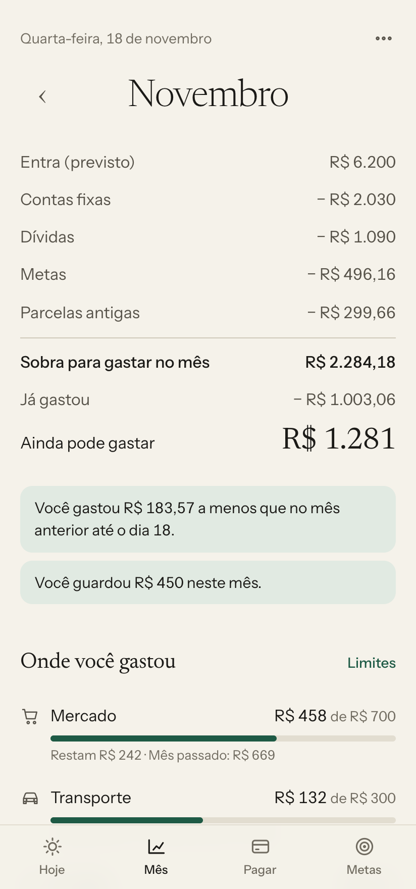
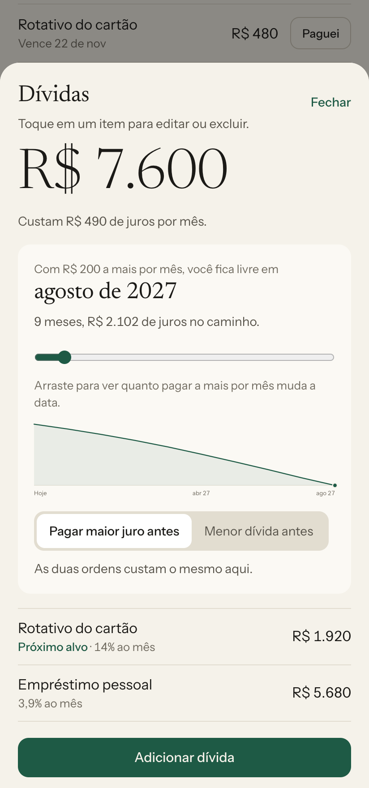
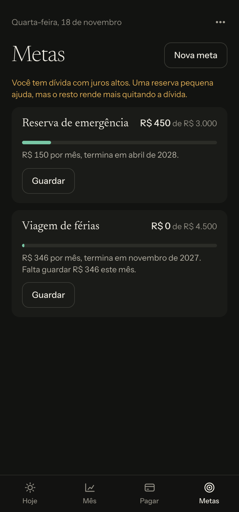
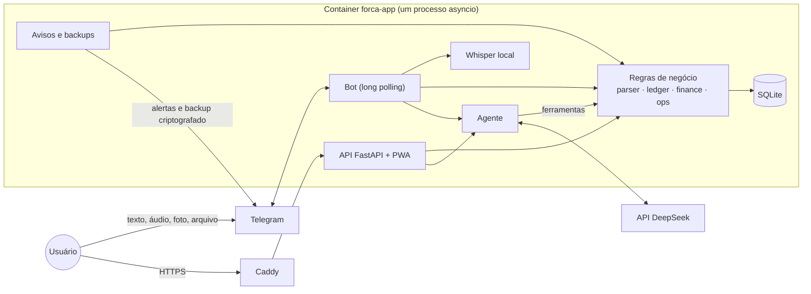

<div align="center">


# Força

**Organização financeira pessoal em torno de um número: quanto você pode gastar hoje.**

App instalável (PWA) e agente no Telegram, com registro em texto, áudio, foto ou extrato bancário.

[](https://github.com/tsmdev-ux/forca-financas/actions/workflows/ci.yml)


[](LICENSE)






<sub>Prints gerados com a demo do repositório. Todos os dados são fictícios.</sub>

</div>

## O problema

A maioria dos apps de finanças é abandonada em poucas semanas: registrar dá trabalho, e os painéis mostram o que já aconteceu, não o que fazer agora. Quem está com a vida financeira bagunçada precisa de uma resposta antes de gastar, não de um gráfico depois.

A Força foi desenhada em torno de três ideias:

1. **Um número só.** A tela abre com o limite do dia, já descontadas contas, dívidas, parcelas e metas.
2. **Registrar em segundos, onde você já está.** `mercado 87` no Telegram resolve, e o extrato do banco pega o que faltou, sem duplicar.
3. **O alerta chega antes do problema.** Véspera de vencimento, fatura perto de fechar e, na hora da compra, uma resposta clara.

## O que ele faz

| Área | Recursos |
|---|---|
| **Limite do dia** | Cálculo diário que considera renda, contas fixas, dívidas, parcelas, metas e o estouro do mês anterior |
| **Registro** | Texto em linguagem natural, áudio transcrito no servidor, foto de comprovante e extratos em OFX, CSV e PDF |
| **Importação** | Reconhece os formatos dos bancos brasileiros e concilia com o que já foi registrado à mão |
| **Cartões** | Calcula a fatura certa pela data de fechamento e projeta as parcelas nos meses seguintes |
| **Dívidas** | Simula a quitação, compara estratégias e avisa quando o pagamento mínimo nunca quita a dívida |
| **Freio de impulso** | `posso comprar um tênis de 400?` dá um veredito e oferece esperar 24 horas |
| **Limites e relatórios** | Limite por categoria com alertas, comparação entre meses e maiores gastos |
| **Metas** | Valor, prazo, previsão de término e reserva do valor mensal no orçamento |
| **Agente** | Conversa em português e opera o sistema por ferramentas, sem fazer contas por conta própria |
| **Avisos** | Bom-dia, véspera de vencimento, fatura fechando, ritmo do mês e resumo semanal, com teto diário |

## Stack

| Camada | Tecnologia | Por quê |
|---|---|---|
| Backend | Python 3.12, FastAPI, Uvicorn | Tipagem e validação com pouco código, e um só processo para API, bot e avisos |
| Dados | SQLite em modo WAL | Um usuário, sem servidor de banco, com backup em um arquivo |
| Frontend | PWA em JavaScript puro, HTML e CSS | Sem etapa de build, instalável no Android, tema claro e escuro |
| Bot | API do Telegram com long polling, via HTTPX | Não exige porta aberta nem webhook |
| IA | API do DeepSeek (function calling, visão e JSON) | Agente de conversa e leitura de fotos e PDFs |
| Voz | faster-whisper (CTranslate2), rodando no servidor | O áudio não sai da máquina |
| Documentos | pypdf, leitores próprios de OFX e CSV | Importação sem depender de IA, exceto foto e PDF |
| Segurança | AES-256-GCM e scrypt (`cryptography`), sessão com HMAC | Backup criptografado e autenticação sem dependências pesadas |
| Infraestrutura | Docker Compose, Caddy (HTTPS), GitHub Actions | Deploy reproduzível e CI com linter e testes |
| Qualidade | pytest, pytest-cov, Ruff | Testes de regra, integração e fluxo do bot |

## Arquitetura



**Princípio central: a aritmética nunca é da IA.** Toda conta acontece em `finance.py`, em código testado. O agente só decide qual ferramenta chamar e redige a resposta. Mensagens comuns, como `mercado 87`, são resolvidas por um parser local, de graça e sem rede.

Mais detalhes em [Arquitetura](docs/arquitetura.md), [Regras financeiras](docs/regras-financeiras.md) e [Decisões técnicas](docs/decisoes.md).

## Rodar localmente

A demo sobe com dados fictícios, sem Telegram e sem IA:

```bash
git clone https://github.com/tsmdev-ux/forca-financas.git
cd forca-financas
python3.12 -m venv .venv
.venv/bin/pip install -r requirements-dev.txt
.venv/bin/python scripts/demo.py
```

Abra http://127.0.0.1:8000 e entre com a senha `demo`.

Para rodar a verificação completa:

```bash
.venv/bin/ruff check forca tests scripts
.venv/bin/pytest --cov=forca
```

Para colocar em produção, veja o [guia de deploy](docs/deploy.md).

## Como usar

| Você escreve | O que acontece |
|---|---|
| `mercado 87` | Registra e diz quanto ainda cabe hoje |
| `uber 23,50 ontem` | Registra com a data certa |
| `tv 1200 10x nubank` | Parcela, lança nas faturas certas e compromete os meses seguintes |
| `aluguel 1200 todo dia 10` | Cadastra uma conta fixa |
| `posso comprar um tênis de 400?` | Dá um veredito e oferece esperar 24 horas |
| `guardei 200 na reserva` | Registra dinheiro guardado em uma meta |
| `nada hoje` | Marca o dia como sem gasto |
| `/comecar` | Cadastro por conversa, uma pergunta por vez |
| Áudio, foto, CSV, OFX ou PDF | Lê e registra sem duplicar |

## Qualidade e segurança

- **Testes:** cobrem regras financeiras, importação, API, conversas do bot, agente com API simulada, avisos e backup. A cobertura medida é de 80%; o CI roda linter, formatação e testes a cada push.
- **Dinheiro em centavos inteiros:** nunca em ponto flutuante. Parcelas somam exatamente o total da compra.
- **Autenticação:** cookie assinado, `HttpOnly`, `Secure` e `SameSite=Strict`, com limite de tentativas de login e CSP restritiva.
- **Bot com dono único:** pareado por código de uso único; mensagens de qualquer outra pessoa são ignoradas em silêncio.
- **Documento não dá ordens:** a leitura de PDF e foto roda sem ferramentas, então um arquivo malicioso não tem o que acionar.
- **Backups:** cópia local diária e uma cópia semanal criptografada fora do servidor.

## Limitações conhecidas

- Foi feito para **um único usuário** por instalação.
- A conexão automática com bancos (Open Finance) ficou de fora por decisão de projeto; o caminho é registro e extrato. Veja o [motivo](docs/decisoes.md#6-extrato-em-vez-de-open-finance).
- O saldo das dívidas evolui por estimativa de juros e precisa de correção manual quando o valor real é conhecido.
- Conversas, fotos e PDFs enviados ao agente passam pela API do DeepSeek. Registro simples, CSV, OFX e transcrição de áudio ficam só no servidor.
- O app organiza finanças pessoais; não substitui orientação profissional de investimento, jurídica ou tributária.

## Estrutura

```
forca/
├── parser.py       texto livre → lançamento, sem IA
├── finance.py      todas as contas: limite do dia, faturas, dívidas, relatórios, metas
├── ledger.py       gravação de lançamentos, parcelas e vínculos
├── ops.py          operações validadas, usadas por app, bot e agente
├── importers.py    OFX, CSV e conciliação com o que já foi registrado
├── ai.py           agente com ferramentas e leitura de documentos
├── bot.py          bot do Telegram
├── onboarding.py   cadastro por conversa
├── nudges.py       avisos e backups
├── backup.py       criptografia dos backups
├── transcribe.py   voz para texto
├── web.py          API e autenticação
└── static/         PWA
scripts/demo.py     demo com dados fictícios
tests/              testes automatizados
docs/               documentação técnica
```

## Licença

[MIT](LICENSE)
