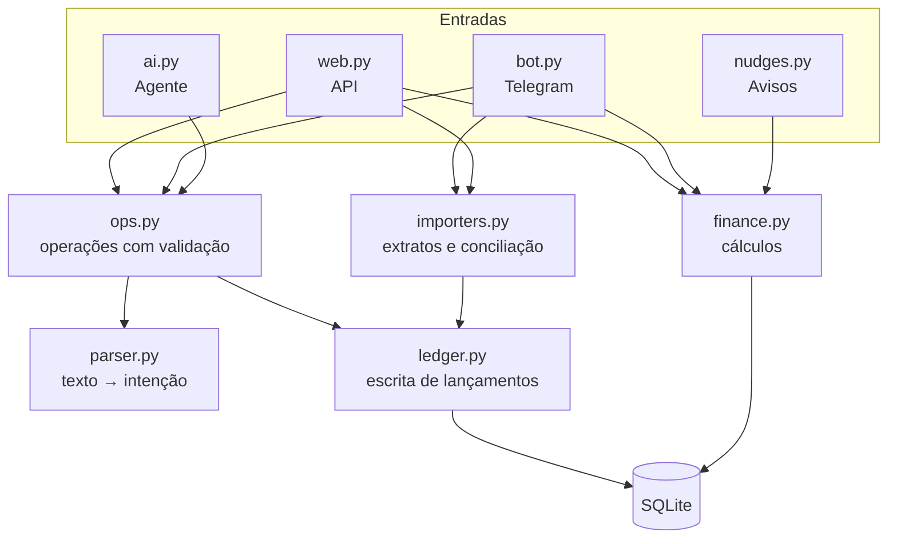
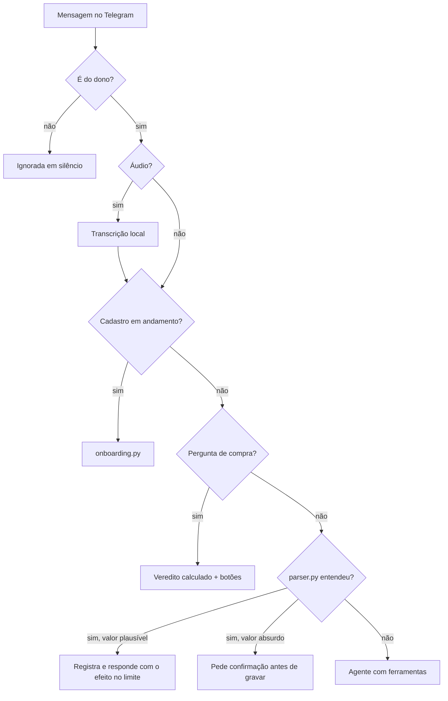
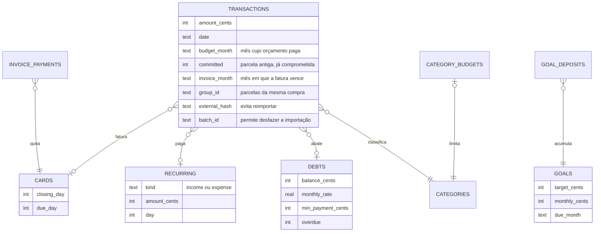

# Arquitetura

## Visão geral

A Força roda em **um único processo Python**, com três tarefas no mesmo loop `asyncio` (`forca/main.py`):

| Tarefa | Módulo | Responsabilidade |
|---|---|---|
| Servidor web | `web.py` | API JSON, autenticação e arquivos do PWA |
| Bot | `bot.py` | Long polling do Telegram, comandos, botões, áudio e arquivos |
| Avisos | `nudges.py` | Ciclo de 60 segundos para alertas, fechamento do mês e backups |

Um processo só mantém a operação simples: um container, um arquivo de banco e nenhum broker. O limite é conhecido e aceitável, porque o sistema atende uma pessoa.

## Camadas

As três entradas passam pelas mesmas funções. Um gasto registrado no app, no bot ou pelo agente segue as mesmas validações e os mesmos vínculos.

## O caminho de uma mensagem

Essa ordem é o que mantém a resposta instantânea e o custo baixo: a IA só entra quando o caminho determinístico não resolve. E ela não recebe nenhuma mensagem com aparência de lançamento simples.

### O agente

O laço fica em `ai.chat`, com ferramentas definidas em JSON Schema e executadas por `run_tool`:

1. Envia prompt de sistema, histórico curto e a mensagem, com a data de hoje na própria mensagem, para manter estável o prefixo em cache.
2. Executa as chamadas de ferramenta dentro de uma transação. Argumento inválido volta para o modelo como erro legível, para ele corrigir.
3. Repete até a resposta final, com limite de rodadas.

Se a API estiver fora do ar, sem saldo ou com limite de uso, o bot informa isso e o registro simples continua funcionando.

## Modelo de dados

Tabelas de apoio: `settings`, `merchant_categories` (aprendizado de categorias), `pauses` (freio de impulso), `zero_days`, `nudge_log` (evita aviso repetido) e `chat_history`.

Uma compra parcelada é gravada como **uma linha por parcela**, cada uma com seu mês. Assim, faturas futuras e orçamentos saem de consultas simples, sem lógica especial de projeção.

## Importação e conciliação

`importers.py` lê OFX e CSV: localiza o cabeçalho, trata separadores e formatos de valor e data brasileiros, e deduz se o arquivo é fatura ou extrato. Para cada item:

1. **Hash do conteúdo:** impede reimportar a mesma linha. Um índice diferencia duas compras iguais no mesmo dia.
2. **Movimentação interna:** pagamento de fatura e aplicações são ignorados, porque não são gastos.
3. **Conciliação:** um registro manual de mesmo valor, de até 3 dias antes a 1 dia depois da data do banco, é vinculado em vez de duplicado.
4. **Parcelas:** `Parcela 2/3` projeta as restantes. Na fatura seguinte, a parcela é reconhecida e não duplica.

Cada importação tem um `batch_id`, e dá para desfazê-la inteira com um toque.

## Avisos

O ciclo de `nudges.py` decide o que enviar e grava cada envio em `nudge_log` na mesma transação, o que impede repetição mesmo se o processo reiniciar. Regras de convivência:

- Silêncio entre 22h e 7h, e `/silencio` pausa tudo.
- Avisos opcionais têm teto de 3 por dia. Vencimentos não entram no teto.
- Cada horário tem uma janela de tolerância: após um reinício, o app não manda "bom dia" à noite.

## Segurança

| Risco | Medida |
|---|---|
| Acesso não autorizado ao app | Senha, cookie com HMAC, `HttpOnly`, `Secure`, `SameSite=Strict`, limite de tentativas |
| Scripts injetados | CSP sem script inline, escape de todo dado na interface |
| Estranhos falando com o bot | Pareamento por código; depois disso, outros chats são ignorados |
| Token em logs | Log do HTTP silenciado e mensagens de erro sem a URL com o token |
| Injeção de prompt por documento | Leitura de documento sem ferramentas e com saída em JSON validada |
| Perda do servidor | Backup semanal criptografado com AES-256-GCM, com chave derivada da senha por scrypt |
| Dados financeiros no cache do navegador | O service worker guarda só a interface; respostas da API não são armazenadas |
